# Mini-XDR Showcase

Mini-XDR is an independent **security monitoring, incident investigation, and response lab**. Its strongest demonstrated use case is a controlled Cowrie SSH honeypot workflow: suspicious authentication activity enters a monitoring application, generates investigation records, and can lead to application-reported firewall-based IP containment.

This repository is a **sanitized technical case study**, not a production security service or a claim that every architecture diagram and interface feature was deployed. The sample detections, diagrams, policies, and screenshots help explain additional design ideas.

> **Start here:** [Implementation & validation status](docs/validation-status.md) distinguishes historically tested lab behavior, illustrative designs, development responsibilities, and evidence limitations.

## Hands-On Lab Work

In a controlled environment, I configured and exercised:

- **Cowrie SSH honeypot testing:** Generated and observed suspicious authentication activity.
- **Security monitoring and investigation:** Viewed collected event details, detections, and generated incident records in an analyst-facing application.
- **Response workflow testing:** Tested IP block/unblock actions and reviewed application-reported UFW containment and action history.

These are historical hands-on test observations; this public showcase does not independently reproduce or verify the underlying private application today. The response UI and logged outcomes should not be mistaken for independent host-level firewall verification.

## Broader Designs and Examples

The repository also explores normalized multi-source telemetry, Sigma-style detection logic, SIEM/SOAR-style architecture, AI-assisted triage, policy-gated response, audit trails, and cloud monitoring concepts. **Those materials are architectural illustrations or sanitized examples unless specifically identified as tested.**

## Development Approach

I planned the requirements, architecture, workflows, and tests, and directed implementation with **Claude and Cursor for coding and code-level debugging**. I personally worked with the lab, tested application behavior, identified issues, and guided subsequent fixes and retesting. This is different from claiming that I independently authored all the source code.

## What This Repository Does Not Include

- Production source code
- Secrets, credentials, API keys, or live infrastructure details
- Customer data or real incident data
- Proprietary orchestration internals
- Claims of formal compliance certification

Public example events and policy artifacts use synthetic data. Screenshots use sanitized demonstration content; they are not evidence that every pictured component or integration was operating live.

## Architecture Overview (Reference Design)

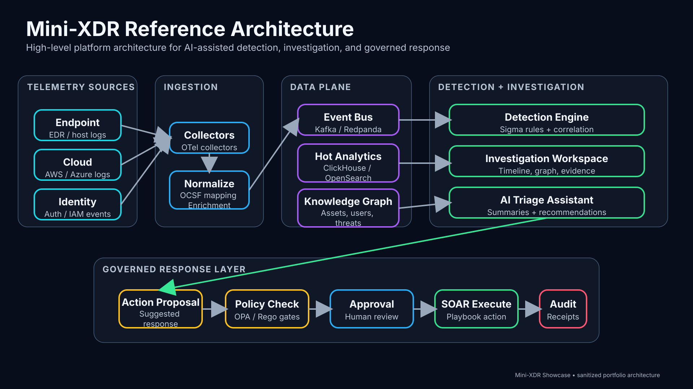

## Recommended Reading Path

For a technical reviewer, start here:

1. Read [implementation & validation status](docs/validation-status.md) to distinguish tested functionality from design examples.
2. Review this README for the project overview.
4. Review [docs/architecture.md](docs/architecture.md) for the control plane, data plane, and reasoning plane design.
4. Review [docs/detection-pipeline.md](docs/detection-pipeline.md) for detection logic, normalized events, and Sigma-style examples.
5. Review [docs/ai-workflow.md](docs/ai-workflow.md) for the AI-assisted triage boundary.
6. Review [docs/soar-governance.md](docs/soar-governance.md) for policy-gated response workflows.
7. Review [docs/lessons-learned.md](docs/lessons-learned.md) for tradeoffs, design decisions, and future improvements.

## Architecture and Interface Areas (Illustrative Scope)

These entries describe documented workflows and sanitized UI examples; they are **not** an inventory of independently validated live integrations.


| Area | What It Shows |
| --- | --- |
| Dashboard | Incident queue, risk posture, alert volume, policy status, and analyst workflow |
| Investigation Workspace | Timeline, entity pivots, evidence review, graph context, and AI-assisted analysis |
| Detection Engineering | Sigma-style detections, ATT&CK mapping, severity, and false-positive notes |
| AI Triage | Evidence-grounded summaries, confidence scoring, response recommendations, and analyst review |
| SOAR Governance | Policy checks, approval routing, rollback notes, and kill-switch controls |
| Risk Modeling | Blast radius scoring, entity relationships, and attack path context |
| Auditability | Decision logs, evidence mapping, policy receipts, and review-ready documentation |

## Example Artifacts

- [examples/sigma/suspicious-encoded-command.yml](examples/sigma/suspicious-encoded-command.yml)
- [examples/sigma/impossible-travel-service-account.yml](examples/sigma/impossible-travel-service-account.yml)
- [examples/ocsf/finding-event.json](examples/ocsf/finding-event.json)
- [examples/ocsf/authentication-events.jsonl](examples/ocsf/authentication-events.jsonl)
- [examples/rego/action-approval.rego](examples/rego/action-approval.rego)
- [examples/playbooks/contain-compromised-endpoint.yml](examples/playbooks/contain-compromised-endpoint.yml)
- [examples/infrastructure/otel-collector-snippet.yml](examples/infrastructure/otel-collector-snippet.yml)

## Diagrams

### Reference Architecture

<a href="diagrams/reference-architecture.md"></a>

### Telemetry Flow

<a href="diagrams/telemetry-flow.md">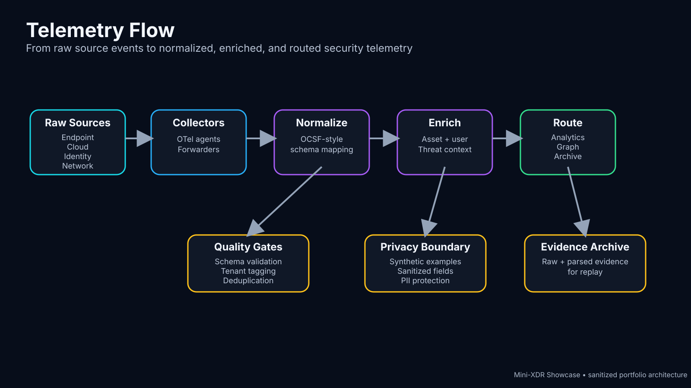</a>

### SIEM Ingestion Pipeline

<a href="diagrams/siem-ingestion.md">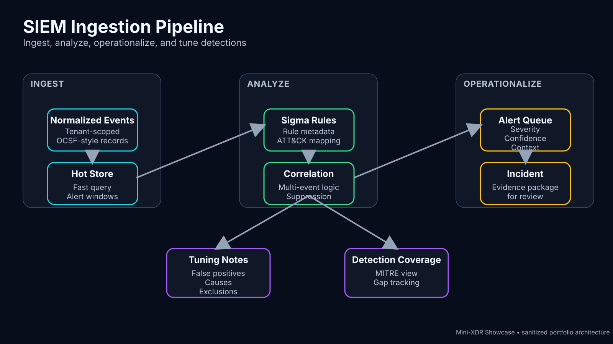</a>

### AI Triage Workflow

<a href="diagrams/ai-triage-workflow.md">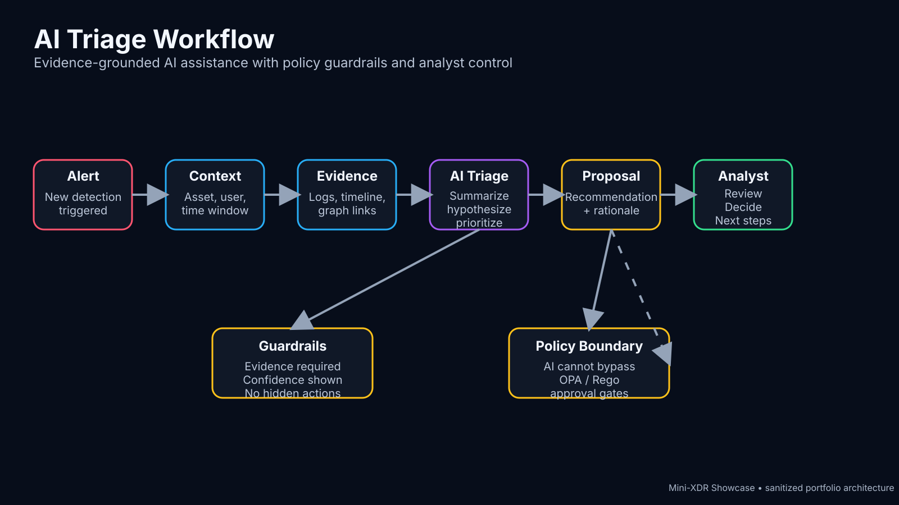</a>

### SOAR Approval Flow

<a href="diagrams/soar-approval-flow.md">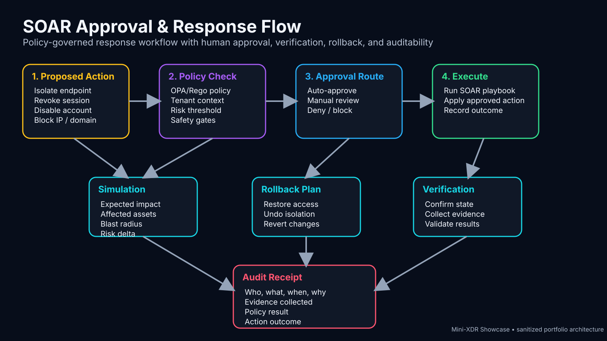</a>

### AWS-Style Reference Architecture

<a href="diagrams/aws-reference-architecture.md">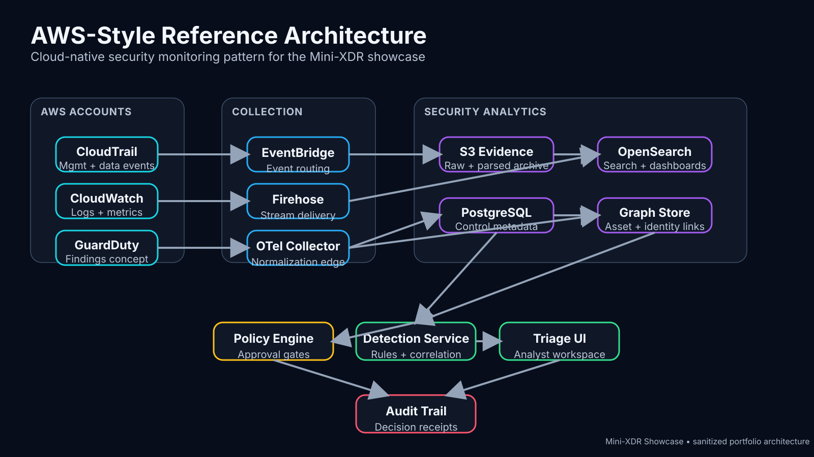</a>

## Screenshots

Screenshots are sanitized demonstrations. Some show experimental or designed interfaces that do not establish a working external integration, trained-model accuracy, or completed response action. See [validation status](docs/validation-status.md).


Screenshot guidance is tracked in [assets/screenshots/README.md](assets/screenshots/README.md). Click any image below to open the full-size version.

### Featured Investigation Workspace

<a href="assets/screenshots/investigation-workspace.png">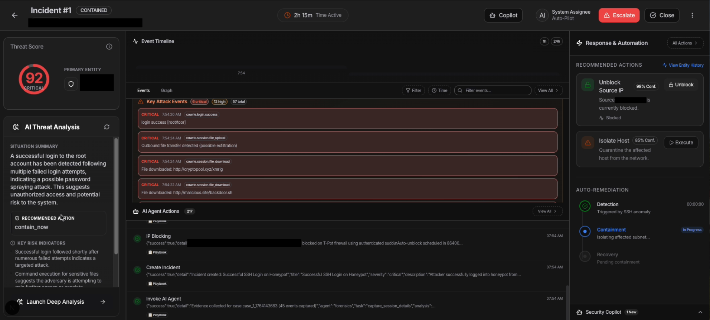</a>

| Dashboard Overview | Incident Queue |
| --- | --- |
| <a href="assets/screenshots/dashboard-overview.png">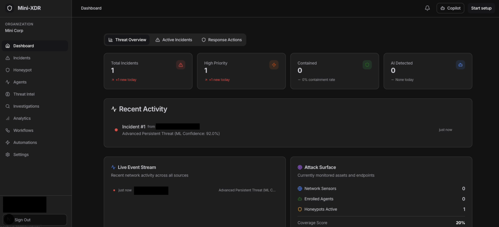</a> | <a href="assets/screenshots/incident-queue.png">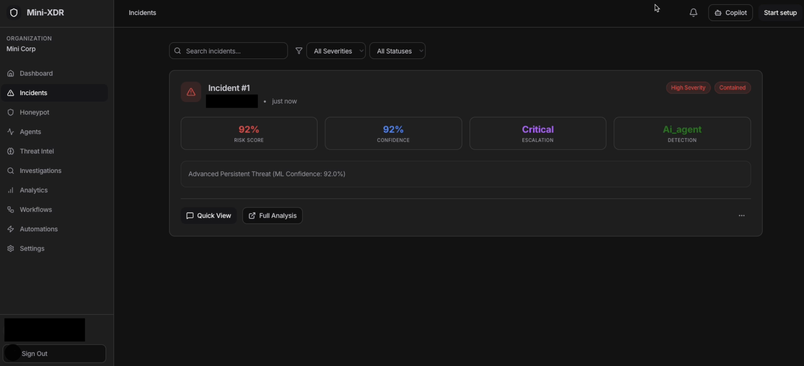</a> |

| Action History | Workflow Overview |
| --- | --- |
| <a href="assets/screenshots/action-history.png">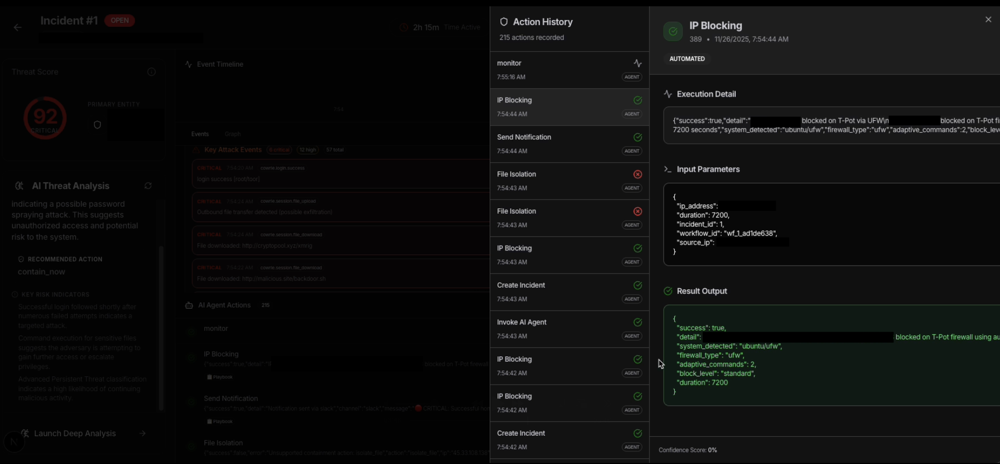</a> | <a href="assets/screenshots/workflow-overview.png">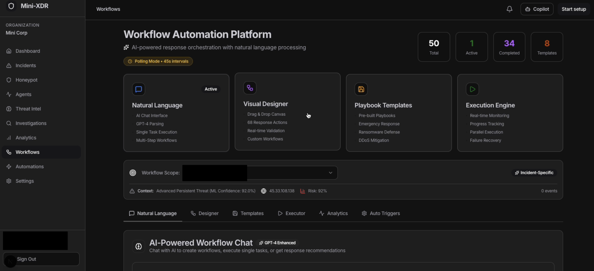</a> |

| Workflow Templates | AI Workflow Chat |
| --- | --- |
| <a href="assets/screenshots/workflow-templates.png">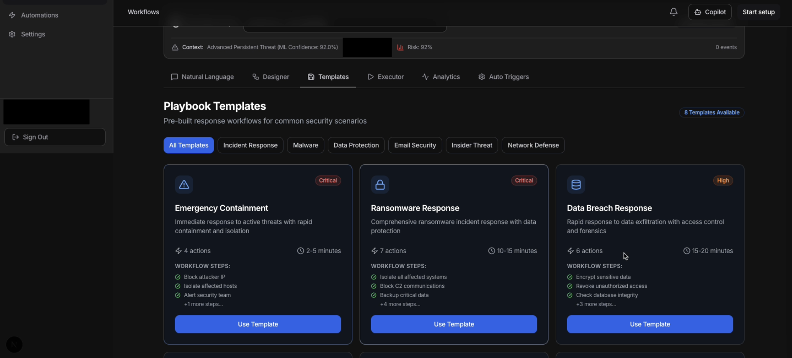</a> | <a href="assets/screenshots/ai-workflow-chat.png">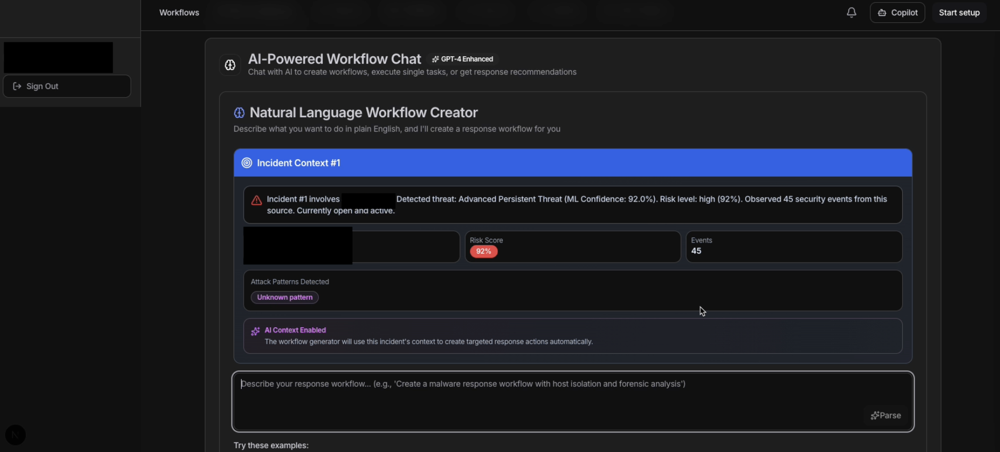</a> |

| Agent Command Center | Honeypot Monitoring |
| --- | --- |
| <a href="assets/screenshots/agent-command-center.png">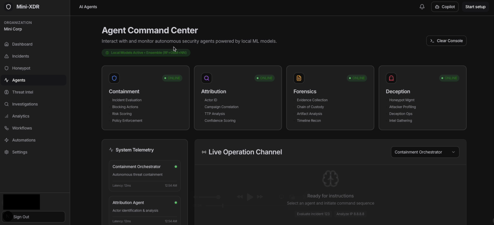</a> | <a href="assets/screenshots/honeypot-monitoring.png">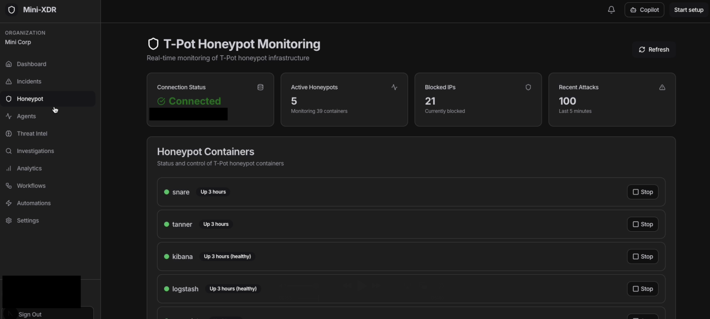</a> |

## Repository Structure

```text
.
|-- README.md
|-- docs/
|   |-- architecture.md
|   |-- detection-pipeline.md
|   |-- ai-workflow.md
|   |-- soar-governance.md
|   `-- lessons-learned.md
|-- diagrams/
|   |-- reference-architecture.md
|   |-- telemetry-flow.md
|   |-- siem-ingestion.md
|   |-- ai-triage-workflow.md
|   |-- soar-approval-flow.md
|   `-- aws-reference-architecture.md
|-- examples/
|   |-- sigma/
|   |-- ocsf/
|   |-- rego/
|   |-- playbooks/
|   `-- infrastructure/
|-- assets/
|   |-- diagrams/
|   `-- screenshots/
|-- SECURITY.md
`-- LICENSE
```

## Security Design Principles

Mini-XDR is built around a simple principle:

AI can assist investigation, but deterministic controls must govern response.

The examples and design explore safeguards including:

- Tenant context on every event, query, finding, and action proposal
- AI responses grounded in evidence, confidence, expected impact, and rollback notes
- High-risk actions routed through policy checks and human approval
- Response workflows designed to suggest, simulate, approve, execute, verify, and audit
- Public examples limited to synthetic data and sanitized documentation

## Technologies Represented in Examples and Design

Listing a technology here does not imply it was integrated into the tested Cowrie-to-response lab.


| Category | Technologies / Concepts |
| --- | --- |
| Frontend | Next.js, React, TypeScript, dashboard UX, investigation workspace |
| Telemetry | OpenTelemetry Collector, OCSF-style normalization |
| Streaming | Kafka / Redpanda-style event bus |
| Analytics | ClickHouse / OpenSearch-style hot analytics |
| Control Plane | PostgreSQL-style tenant and workflow data |
| Detection | Sigma-style rules, MITRE ATT&CK mapping, SIEM query concepts |
| Policy | Open Policy Agent, Rego, approval gates, kill-switch design |
| Graph | Neo4j-style entity and relationship modeling |
| Response | SOAR workflows, CACAO-style playbooks, OpenC2-style action semantics |
| AI Governance | Evidence-grounded triage, mediated tools, replayable decisions, audit logging |

## Lessons Learned

The strongest design choice was separating deterministic control from probabilistic reasoning.

- Use AI for synthesis, prioritization, explanation, and recommendations.
- Use policy engines for authorization, approvals, tenancy, and safety gates.
- Use normalized event contracts for consistent detection logic.
- Use graph modeling where relationships materially improve investigation.
- Treat auditability as a core security feature, not an afterthought.

## Status

This is a documentation-first, sanitized portfolio case study that includes historical controlled-lab testing and broader architectural exploration. The private application is not supplied for independent reproduction in this repository. Read [implementation & validation status](docs/validation-status.md) for evidence boundaries and next verification steps.
